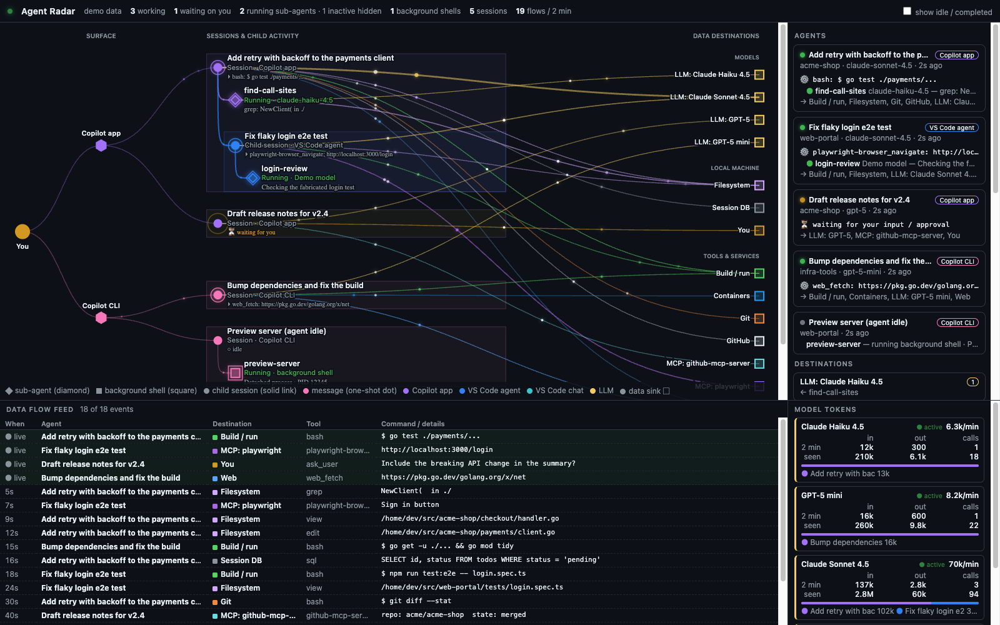

# Agent Radar

Agent Radar is a canvas extension for the GitHub Copilot app.
The canvas shows the Copilot agents that are active on this computer.
It also shows their sub-agents, their commands, and the destinations of their data.



## Features

- The canvas shows sessions from the Copilot app, the Copilot CLI, and VS Code.
- The layout has five columns: You, surface, sessions, sub-agents, and data destinations.
- Each line shows one data flow from an agent to a destination.
- Sessions have circle markers, sub-agents have diamond markers, and detached background shells have square markers.
- Sub-agents are in a box below their parent session. Each sub-agent shows its status and its current task below its name.
- A session that another session created is below its parent, with a solid line between the two sessions. This line stays when the creation is old.
- When a child session works, the canvas also shows its idle parent sessions as "Idle parent context".
- Each new message between sessions moves one time as a dot along the line between the two sessions. The canvas does not add a different line for messages. The feed shows the text of the message.
- A background sub-agent can start again after it completes. The canvas shows its new turns and tools on the same sub-agent.
- Select "show idle" to see all the completed sub-agents of the sessions.
- A detached background shell is below its session. The shell stays on the canvas when its agent is idle or stops. The canvas does not count a shell as an agent or a sub-agent.
- If the window is narrow, you can scroll the map.
- A destination can be a model, a local resource, or a different tool or service.
- The group "Local machine" contains only destinations that keep the data on this computer.
- The group "Tools & services" can contain local tools and remote services.
  Shell, build, and container commands are in this group, because they can send data to remote systems.
- The name of an MCP destination is the name of the MCP server.
  If the radar cannot find the server name, the destination is "MCP: unknown server".
- The feed below the map shows the full command of each tool call.
- The token panel shows the tokens for each model. The active models are at the top.
- VS Code does not record model calls. For VS Code chat sessions, the panel shows "–" for calls. If the panel adds known calls to VS Code usage, the number has a "+" after it.
- By default, the canvas shows only agents that work or wait for you.
- You can use the keyboard to select agents and destinations in the side panel.
- When you select a session, the side panel shows its details below the card.
  The details show the prompt, the folder, the model, the tokens, and each sub-agent.
  Each sub-agent has a row that you can open with the keyboard to show its reply and its current task.
- If the operating system is set to reduce motion, the canvas does not show animations.

## Requirements

- GitHub Copilot app with canvas support

## Usage

1. Install the plugin:

   ```bash
   copilot plugin install agent-radar@awesome-copilot
   ```

2. In the Copilot app, open **Canvases**.
3. Open **Agent Radar**.

## Canvas action

The canvas has one action, `snapshot`.
The action gives a JSON summary of the agents.
The summary gives the names of the tools that run now, but not their arguments.
When `activeOnly` is `true`, the summary shows only agents that work or wait for you, and sessions that have a detached background shell.
The default value of `activeOnly` is `true`.

For each detached background shell, the summary gives only the shell ID, the process ID, and the start time. It does not give the command or the log.

```js
invoke_canvas_action({ instanceId: "radar-main", actionName: "snapshot", input: { activeOnly: true } })
```

## Demo mode

Add `?demo` to the canvas URL to show sample data.
In demo mode, the UI does not read local session data.
The preview image shows demo mode.

## Privacy

The extension reads only local files. The extension does not send requests to the network.

The extension reads these files:

- `$COPILOT_HOME/session-state/*/events.jsonl`, `workspace.yaml`, and the `inuse.*.lock` files.
- `$COPILOT_HOME/session-state/*/detached-shells/*.json`. The extension uses only the shell ID, the start time, and the supervisor process.
  On Linux, the extension also reads `/proc/sys/kernel/random/boot_id` and `/proc/<pid>/stat`. These files make sure that the process is the same process that started the shell.
- `$COPILOT_HOME/ide/*.lock`.
- For VS Code, VS Code Insiders, Cursor, and VSCodium, in the folder of each product in the application-data folder:
  - `User/workspaceStorage/*/chatSessions/*` and `User/workspaceStorage/*/workspace.json`.
  - The `.code-workspace` file of a multi-root window, to find its folders.
  - `User/globalStorage/emptyWindowChatSessions/*`.

The default value of `$COPILOT_HOME` is `~/.copilot`.

The application-data folder is:

- `$VSCODE_APPDATA`, if you set this variable.
- On Windows: `%APPDATA%`. If `APPDATA` is not set, `~/AppData/Roaming`.
- On macOS: `~/Library/Application Support`.
- On Linux: `$XDG_CONFIG_HOME`. If `XDG_CONFIG_HOME` is not set, `~/.config`.

The `snapshot` action gives session data to the agent that calls the action.
This data includes session names, folders, repositories, tool names, and data destinations.
The agent can send this data to its model.
The action does not give command arguments, because arguments can contain credentials.
The full commands are only in the local UI.

## Tests

Use Node.js 18 or later. Run this command in the folder of the extension:

```bash
node --test collector.test.mjs graph.test.mjs
```

The tests use only sample data.

The HTTP server listens only on `127.0.0.1`. The first port is 47800.
Each server start makes a new random token in the URL path.
The server does not accept a request without the token, or a request with a different `Host` or `Origin` header.
The UI does not load scripts or styles from external servers.

## Troubleshooting

- If the header shows "disconnected — data is stale" and a red dot, the canvas does not get new data.
  Reload the extensions and open the canvas again.
- If the extension has the status `failed`, read the extension log in the Copilot app.

## License

MIT. Refer to [LICENSE](LICENSE).
