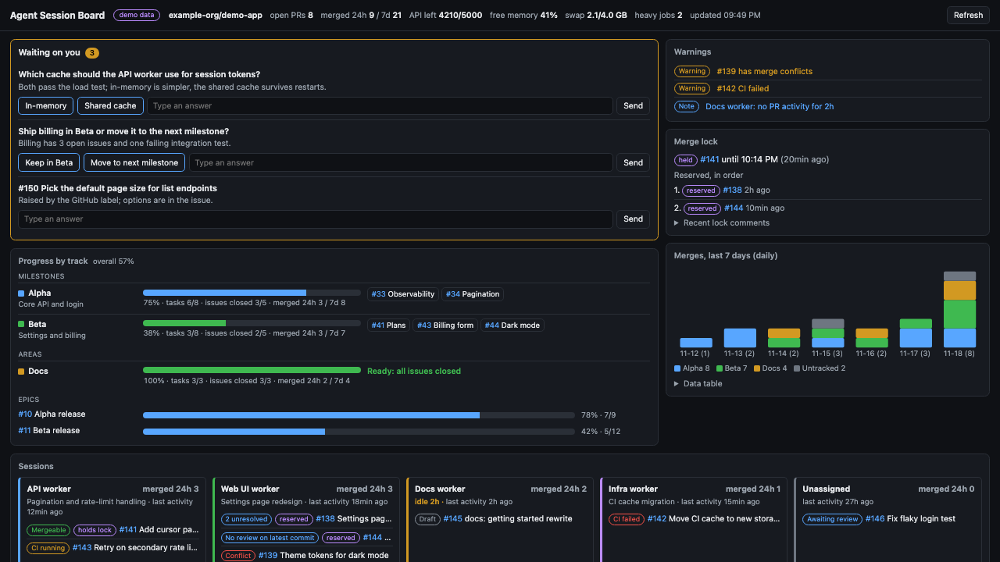

# Agent Session Board

A canvas for supervising several Copilot agent sessions that work on one GitHub repository through issues, pull requests, reviews and merges. One screen answers: what is waiting on me, how far along is each milestone, which PR is stuck at which gate, and how fast is work landing.



## What it shows

- **Waiting on you**: questions that agents put on the board (choice buttons or a free answer), plus open issues carrying a decision label. Agents read the answers back with `get_answers`. An answer is tied to the exact version of its question (title, detail, options and link), so a question revised under the same id starts unanswered and never receives, returns or is hidden by an answer meant for the old one.
- **Progress by track**: one row per configured label (milestone, area, phase, …) with checklist progress from issue bodies, closed/total issues, and merges in the last 24 hours and 7 days. A track with no open issues shows as ready; if a label has more issues than one refresh loads, its numbers are marked partial and it is never shown as ready. Optional epic bars use GitHub sub-issue progress.
- **Sessions**: one card per agent session with its open PRs. Each PR shows the first merge gate it has not passed: draft, conflict, CI failed, CI running, changes requested, unresolved threads, threads not fully loaded, awaiting review, no review on the latest commit, mergeability still being computed by GitHub, behind the base branch, blocked by branch rules, or mergeable. Sessions idle longer than `idleMinutes` are flagged. PRs that match no session appear under *Unassigned*.
- **Merge flow**: stacked bars for the last 24 clock hours (including the current hour) and the last 7 calendar days (including today), colored by track, plus a recent-merge list. The 24-hour and 7-day totals count exactly those bars. Times use your machine's time zone. Each chart has a data table for screen readers and keyboard users.
- **Warnings**: CI failures, conflicts, PRs idle for a day, idle sessions, an expired merge lock, a low GitHub API budget, data that was too large to load completely, and (optional) local memory, swap and heavy-process limits.
- **Local resources** (optional, off by default): with `localResources.enabled`, the header shows free memory, swap use and the number of running processes that match `heavyPattern`.
- **Merge lock** (optional): reads lock, reserve and release lines from comments on a coordination issue.

The board is in English. Set `language: "ko"` with `configure_board` to show it in Korean.

## Open it

```text
open_canvas agent-session-board { "repo": "owner/name" }
open_canvas agent-session-board { "demo": true }
```

`demo: true` shows fictional sample data and needs no GitHub access.

## Actions

| Action | Purpose |
| --- | --- |
| `refresh` | Collect from GitHub now and return a compact summary. |
| `get_summary` | Return the summary, using a one-minute cache. |
| `configure_board` | Set `sessions`, `tracks`, `epics`, `decisionLabel`, `coordinationIssue`, `lockPrefixes`, `lockAuthors`, `localResources`, `idleMinutes`, `language`. Only the fields you pass change. |
| `set_decisions` | Replace (default) or append (`mode: "append"`) the questions waiting on the user. The queue holds up to 50 questions; an append that would exceed that is refused instead of dropping older questions. |
| `get_answers` | Answers given on the board that have not been marked seen, each with its `id` and `at`. |
| `mark_answers_seen` | Pass `answers: [{ id, at }]` from `get_answers`. If the user changed an answer since, it stays unseen and is returned in `changed`. |

Example configuration:

```json
{
  "sessions": [
    { "id": "api", "name": "API worker", "branchPatterns": ["^api/"] },
    { "id": "docs", "name": "Docs worker", "titlePatterns": ["^docs:"], "prs": [42] }
  ],
  "tracks": [
    { "label": "milestone: alpha", "name": "Alpha", "group": "Milestones" },
    { "label": "area: docs", "name": "Docs", "group": "Areas", "titlePattern": "^docs:" }
  ],
  "epics": [{ "number": 10, "name": "Alpha release" }],
  "decisionLabel": "needs-decision",
  "coordinationIssue": 1
}
```

### How a merge is attributed to a track

1. The PR's own labels.
2. The labels of issues the PR closes or references (`#123` in the title or body).
3. The labels of those issues' parent (epic) issues.

If several tracks match at one step, the one listed first wins. Only when no label matches is each track's optional `titlePattern` tried against the PR, issue and parent titles. Anything left is *Untracked*. If an item has more labels than one refresh loads (20), or more body references exist than are resolved (320), the board warns that attribution is partial.

### Session matching

A PR belongs to the first session that lists its number in `prs`; otherwise the first whose `branchPatterns` match the head branch; otherwise the first whose `titlePatterns` match the title.

Patterns are case-insensitive regular expressions matched against at most 256 characters. Because they run against titles and branch names that any contributor controls, patterns that can backtrack catastrophically are rejected: backreferences, and a repeated group that itself contains a quantifier or an alternation (for example `(a+)+`, `(a+){20}` or `(a|ab)*`). Every pattern also runs in a worker thread with a time limit; a pattern that takes too long is skipped and reported, so no pattern can stall the board.

### Merge lock comments

When `coordinationIssue` is set, the first line of each comment from the last 48 hours is read. With the default prefixes:

```text
merge reserve: #138
merge lock: #141 until 14:30Z
merge lock release: #141
```

The expiry is optional and can be an ISO timestamp or `HH:MM` followed by `Z`, `UTC` or an offset such as `+09:00`. Change the prefixes with `lockPrefixes`.

Only comments from authors whose repository permission is verified as write, maintain or admin change the lock lane, so passers-by on a public repository cannot take or release the lock. Verification needs push access to the repository and covers the 50 most recent lock-command authors; comments that could not be verified are ignored and a warning says the lane may be incomplete. To trust a fixed set of accounts instead (no permission lookups), set `lockAuthors` to their GitHub logins.

## Requirements

- GitHub Copilot app with canvas support.
- The [GitHub CLI](https://cli.github.com/) (`gh`), signed in with access to the repository. The board never reads or stores tokens; every GitHub call goes through `gh`.

If `gh` is not installed or not signed in to github.com, the board shows the steps to set it up instead of loading data. `{ "demo": true }` works without `gh`.

## Data and privacy

- The extension starts processes in one place, `lib/exec.mjs`, and only from a fixed allowlist: `gh` for GitHub data, and `ps`, `sysctl` and `memory_pressure` for the optional local resource checks. Commands run without a shell, with arguments as an array, a timeout and an output cap.
- The board runs a local server on `127.0.0.1` with a random port. Every page and API route sits under a random per-panel key that only the canvas host receives, so other local users and web pages cannot read the board or post answers. The key opens only that local board and is not a GitHub credential. The server also requires its own `Host` header, accepts only same-origin JSON posts, and refuses to be framed.
- Board settings, questions and answers are stored per repository in `<copilot-home>/extension-data/agent-session-board/` (`COPILOT_HOME`, or `~/.copilot` when unset). Files carry a format marker and version and are written atomically under a lock file, so several Copilot sessions can share one repository's board without losing updates; a file the extension did not write is left untouched.
- Local resource checks are off by default.

## Development

```bash
node --test test/*.test.mjs
```
