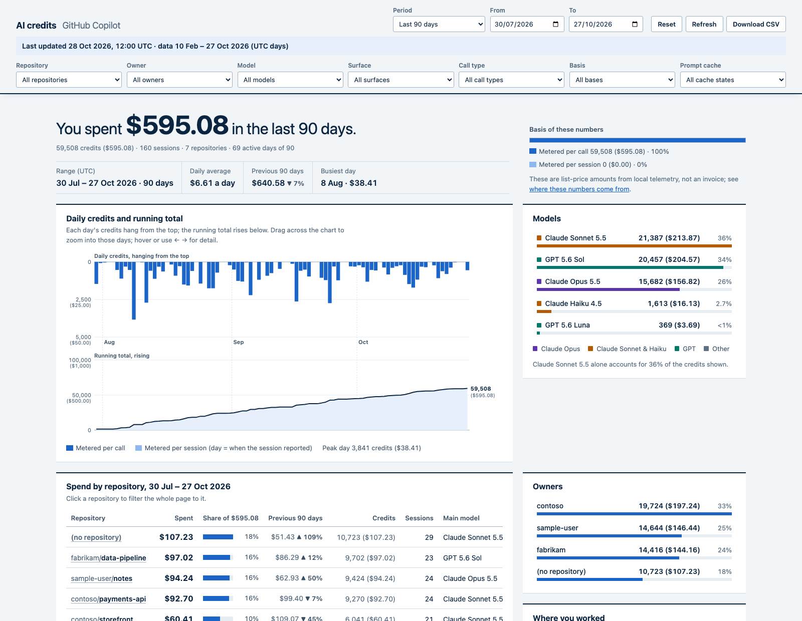

# AI Credits Breakdown

AI Credits Breakdown is a canvas extension for the GitHub Copilot app. It gives you a detailed, private view of your **own** GitHub Copilot AI credit usage (1 AI credit = 1 AIU = $0.01), across every repository, organization and Copilot surface that leaves telemetry on your computer.



The screenshot shows fictional sample data.

## What it shows

One analytics page with a sticky filter bar. Every panel follows every filter.

- **Filters:** period presets (this month to date, last 7/30/90 days, all time, any single month) or an exact from/to date range, plus repository, owner, model, surface, call type, basis and prompt cache. Each dropdown lists its options with their spend under the other filters. Download CSV exports the filtered rows. Filters are kept in the URL hash.
- **Headline:** dollars spent in the range, daily average, pace to month end, the previous comparable period and the busiest day.
- **Daily credits** as a hanging bar chart over a running-total curve. Drag across it to zoom the date range.
- **Spend by repository, model, owner, surface and call type.** Click any row to filter the whole page to it.
- **What credits pay for:** cache reads, cache writes, output and fresh input.
- **When it happens:** an hour-of-week heat map in your local time zone.
- **Prompt cache: reused or rebuilt.** Every metered model call by what it found in the prompt cache (reused, expired after a pause, rebuilt mid-conversation, or a new conversation), with spend, calls, cost per call and what the credits paid for. This shows how much goes to rewriting a conversation into the cache after a break.
- **Heaviest sessions,** and **spend by automation** (Copilot app automations) as a daily line graph.

## Requirements

- GitHub Copilot app with canvas support
- Node 22.13+ (uses `node:sqlite`)
- Copilot CLI or Copilot app usage on this computer. Without any, the panel tells you no usage was found yet.

## Usage

1. Install the plugin:

   ```bash
   copilot plugin install ai-credits-breakdown@awesome-copilot
   ```

2. In the Copilot app, open **Canvases**.
3. Open **AI Credits Breakdown**. The canvas takes an optional `period` (`mtd`, `7d`, `30d`, `90d` or `all`) to choose the first range.
4. Use **Refresh** to read your latest telemetry.

## Canvas action

The canvas has one action, `get_summary`, so you can ask Copilot questions such as "how much did I spend on Opus this month?". It takes an optional `from` and `to` (`YYYY-MM-DD`, UTC days) and returns totals in credits and USD, the top models, repositories, surfaces and call types, the prompt-cache states and the busiest days. It does not return session ids, prompts or titles.

## How the numbers are built

The extension reads, read-only, from `COPILOT_HOME` (default `~/.copilot`):

| Source | Gives |
| --- | --- |
| `session-store.db` `assistant_usage_events` | Exact nano-AIU per model call, with model, call type, token counts and the per-token rates in effect |
| `session-state/*/events.jsonl` (`session.shutdown`) | Cumulative per-session, per-model credits and tokens (running maximum; repeats ignored) |
| `session-state/*/events.jsonl` (`session.usage_checkpoint`) | Prompt-cache lifetime per model |
| `data.db` (Copilot app) | Per-session totals, automation names and which sessions an automation ran, and each project's repository |

Each session takes the largest total among the sources, and per-call rows win where they exist. Credits = `total_nano_aiu / 1e9`. Days and months are UTC (as GitHub bills); the hour-of-week grid uses your local time zone.

A call counts as having **reused the cache** when its cache-read tokens are at least half of the previous call's prompt in the same conversation and model. Otherwise it is **expired after a pause** when the previous call went out longer ago than the model's cache lifetime (as recorded by the Copilot CLI, with a default of 5 minutes for Claude and 30 minutes for other models), and **rebuilt mid-conversation** when it was more recent or there was none on that model (a model switch, compaction or a changed prompt). The first call of a conversation is a **new conversation**.

These are consumption figures at list per-token rates, not an invoice. Not captured: Copilot coding agent and code review sessions (they run in the cloud), IDE chat, and other computers.

## Privacy and security

- Everything is computed on your computer. The extension makes no network requests and sends nothing anywhere.
- Prompts, session titles, file paths and URLs are never read into the view. Session ids are shortened to 8 characters, and only repository names (`owner/name`), model ids and automation names are shown.
- The canvas serves its page from a loopback-only HTTP server (`127.0.0.1`). The page and its data are behind a random secret path that changes every time the canvas opens, and the server also checks the `Host` and `Origin` headers, so other local users and web pages cannot read your usage.
- The page loads no scripts or styles from other servers (its Content-Security-Policy allows only itself).
- The tool uses no paid services.

## Development

```bash
cd extensions/ai-credits-breakdown
node --test collector.test.mjs server.test.mjs
```

The tests use only fictional telemetry from `sample-data.mjs`, which writes a fake `COPILOT_HOME`. To try the ledger builder on it:

```bash
node -e 'import("./sample-data.mjs").then((m) => m.writeSampleHome("/tmp/sample-copilot-home", { days: 220 }))'
COPILOT_HOME=/tmp/sample-copilot-home node collector.mjs   # prints a one-line summary; add a path to also write the ledger as JSON
```
