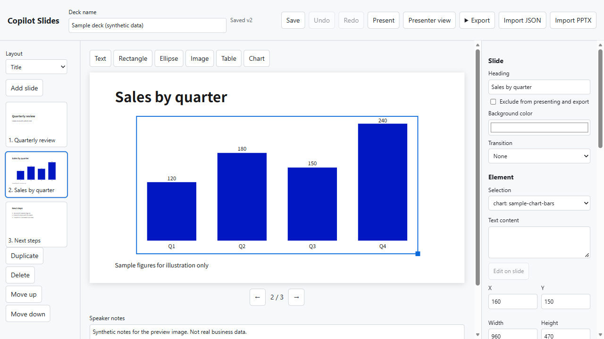

# Copilot Slides

Create, edit, present and export slide decks in a GitHub Copilot app canvas. Copilot builds a deck from your notes and files, you refine it directly on the slide, and every save is revision-safe, so you and Copilot never overwrite each other's work.



## What it does

- Edits slides on a 1280×720 canvas with a slide list and a properties panel. Add title, content or blank slides; duplicate, delete, reorder and skip them.
- Places text, rectangles, ellipses, PNG/JPEG images (with alt text), tables and bar, line or pie charts. Drag to move, drag the corner handle to resize, or type exact numbers. Double-click text to edit it in place.
- Keeps speaker notes, themes, slide backgrounds, a fade transition per slide and click-to-appear or fade-in builds per element.
- Presents in a dedicated window, with a presenter view that shows the current slide, the next slide, notes and a clock.
- Exports standalone HTML, a PNG of the current slide, a printable PDF view, editable JSON and editable PowerPoint (text, shapes, tables, native charts, embedded images, notes, transitions and builds).
- Imports PowerPoint files and can extract colors and fonts from a PowerPoint theme or colors from a logo.
- Saves slide or element comments. **Send to Copilot** hands one to Chat, and Copilot answers it with `reply_comment`.
- Autosaves, offers 50 steps of undo and redo, and keeps your draft when another update arrives first.
- Shows an English or Japanese interface, following your browser or app language.

## Install

```bash
copilot plugin install copilot-slides@awesome-copilot
```

You can also ask Copilot to install the extension from `https://github.com/github/awesome-copilot/tree/main/extensions/copilot-slides`. Reload extensions, then ask Copilot to open the **Copilot Slides** canvas.

## Working with Copilot

Open the canvas with a meaningful `deckId` (the default is `main`), then describe the deck in Chat, for example "Build a five-slide project update from these notes". Copilot reads the deck with `get_deck` and saves it with the version it just read. Figures it does not know go into `openQuestions` instead of being invented.

The canvas provides these actions:

| Action | What it does |
| --- | --- |
| `get_deck` | Reads the deck and its current version. An empty deck starts at version 0 |
| `replace_deck` | Saves a complete deck. Needs the current `expectedVersion` |
| `update_slides` | Replaces only the named slides and keeps everything else |
| `reorder_slides` | Puts the slides in a new order. Every slide ID must appear once |
| `reply_comment` | Replies to a saved comment and optionally marks it resolved |

Opening the canvas accepts two inputs: `deckId`, and `locale` (`auto`, `en` or `ja`) to force the interface language.

A stale `expectedVersion` is rejected instead of overwriting newer work. The editor keeps a conflicting draft and lets you download it before you explicitly discard it. Two panels that open the same `deckId` show the same saved deck.

## Language

The interface is available in English and Japanese. It follows the browser or app language (`navigator.languages`) and falls back to English. To force a language, pass `locale` when opening the canvas or add `?lang=en` or `?lang=ja` to the canvas address. Deck content is never translated. Exported HTML pages use the interface language that was active when you exported.

Translations live in `locale-ja.mjs`, keyed by the English text, so a missing entry simply shows English. `i18n.test.mjs` fails when a string in the source has no Japanese entry or an entry is no longer used.

## Default design

New decks that do not specify a design use a style inspired by the Digital Agency of Japan's [color](https://design.digital.go.jp/dads/foundations/color/) and [typography](https://design.digital.go.jp/dads/foundations/typography/) guidance: a white background (`#ffffff`), dark text (`#1a1a1c`), a restrained blue accent (`#0017c1`) and `"Noto Sans JP", "Yu Gothic", Meiryo, sans-serif`. Fonts are resolved locally and are never downloaded or embedded. The slide adaptation uses 64 px margins, left-aligned 64 px cover and 48 px content headings, 32 px body text, and line heights of 1.4 and 1.5. It is not an official template or a claim of conformance.

Saved themes and slide content are never migrated. Explicit styling wins, and omitting `theme` when replacing an existing deck keeps its saved theme. Choose **Digital Agency inspired (default)** under **Theme** to apply the palette and font to an existing deck without moving anything. Text elements accept a `lineHeight` from 1 to 3.

## Editor

- The slide list scrolls on its own, also in narrow two-column canvases. In the list, Up and Down select the previous or next slide instead of scrolling it.
- In the two-column layout, drag the horizontal divider between the slide editor and the properties panel. With the divider focused, Up and Down move it by 5 percentage points and Home and End jump to 20% and 80%. The ratio is not saved with the deck.
- Select an element on the slide or from the element picker. The numeric position and size fields are the keyboard alternative to dragging. Press Enter on a focused text or shape element to edit it in place, and Escape or Ctrl+Enter to finish.
- Edit table cells and chart labels and values directly in the properties panel, including adding and removing rows and columns. **Edit as JSON (advanced)** is still available. Charts take one series of up to 12 non-negative values.
- Images are embedded (PNG or JPEG, up to 4 MB). No external image address is ever fetched.
- Undo history stays in the tab and is cleared when another update arrives or when a comment is sent to Chat. It is not a version history.
- Only **Send to Copilot** sends a comment. If delivery cannot be confirmed, the editor says so and does not retry on its own.

## Present and export

**Present** opens a dedicated window with only the slide. Use **Fullscreen** when the host allows it, arrow keys to move, and Escape or **Exit presentation** to close. **Presenter view** opens a second window with the current slide, the next slide and the notes. Both stay in sync through `BroadcastChannel`, so they must run in the same browser profile. Excluded slides are skipped.

Some hosts open the system browser without returning a window handle. The editor then waits for the new window to check in with the local server. If nothing arrives within eight seconds, it keeps the editor as it is and offers **Open in browser** and **Present in this panel**.

Each element can appear on click or fade in over 300 ms. Give it a reveal order from 1 to 80; equal numbers appear together. Next, Right Arrow and Space reveal the next group before the next slide. Thumbnails, PNG and PDF show every element. A slide can use a fade transition, and HTML and canvas output respect reduced-motion settings. PowerPoint export keeps the click groups, the effects and the fade transition.

**PDF (print)** opens a print view of every included slide. Print it and choose Save as PDF. The print document needs no inline scripts. PowerPoint export offers your theme font or Arial, and fonts are not embedded, so line wrapping can differ between applications.

## Import from PowerPoint

**Import PPTX** converts text, rectangles and ellipses, embedded PNG and JPEG images, rectangular tables, single-series bar, line and pie charts, speaker notes, fade transitions and basic builds. Placeholders resolve through the layout and master, unrotated groups are expanded into editable elements, and supported master and layout decorations are copied onto each slide.

You review the conversion warnings before anything is replaced, and cancelling keeps the current deck. Warnings stay in `openQuestions`. The PowerPoint file is never modified.

This is not a lossless round trip. Arbitrary shapes, mixed text styling, embedded objects, audio, video, hyperlinks, cropped or rotated elements and complex animations are dropped or simplified, and every dropped object is reported. Files are limited to 22 MB compressed, 60 MB expanded and 2,000 ZIP entries. Encrypted files and XML with a DTD are rejected, and external relationships are never fetched.

**Extract colors and fonts from PPTX** reads the first slide's theme, and **Extract colors from logo** samples a PNG or JPEG. Both ask before changing the background, text, accent and font, and neither touches your content or positions. A logo color is darkened when needed to reach a 4.5:1 contrast ratio against white. **Save theme** and **Import theme** store a reusable theme as a local JSON file.

## Where your data goes

- Decks are JSON files in `$COPILOT_HOME/extensions/copilot-slides/artifacts/decks/` (`~/.copilot` when `COPILOT_HOME` is not set). The panel ID is never a storage key, and the location does not change when the extension is updated.
- Saves use a per-deck lock and an atomic rename. If the process crashes, a leftover `.json.lock` folder needs a manual look before you delete it, and never while another writer is active.
- Nothing is sent to Copilot unless you press **Send to Copilot** or Copilot calls an action itself. Images, themes and decks are never uploaded.
- The model holds up to 60 slides, 80 elements per slide, 200 comments and 100 open questions per deck.

## Security

The canvas is served by a local server on `127.0.0.1` and a random port. Every request except the static assets needs a random per-instance token and a matching `Host` header. Writes must be same-origin JSON and are capped at 22 MB. Responses carry a content security policy that only allows scripts and connections from the server itself, plus `nosniff` and `no-referrer`. The extension makes no requests to the internet and starts no other processes. It uses Node built-ins and two bundled browser libraries, listed below.

## Try it without the Copilot app

```sh
node preview.mjs ./.preview-data preview
```

This starts the same server and interface on your own data folder and prints a loopback address. Chat handoff is disabled in this mode.

## Tests

The tests use Node's built-in test runner. The PowerPoint import, export and presentation tests also need the pinned dev dependencies, so install them first:

```sh
npm ci --ignore-scripts
npm test
```

`vendor.test.mjs` confirms that the two bundled libraries are byte-identical to the npm packages in `node_modules`.
`integration.test.mjs` also loads the browser scripts in page order and verifies that PowerPoint slides and editable chart workbooks use the same JSZip.

The extension has no runtime dependencies. For the dev dependencies, `package.json` uses `overrides` to install `image-size` 2.0.3, because the range that PptxGenJS 4.0.1 declares has known advisories. None of the PptxGenJS builds load `image-size`.

## Third-party notices

PptxGenJS 4.0.1 (MIT) and JSZip 3.10.2 (MIT or GPL-3.0-or-later, used under MIT) are redistributed as browser bundles in `vendor/`, together with the licenses of the packages inside them. See [`vendor/README.md`](vendor/README.md) for sources and checksums.
The page loads JSZip once, before the PptxGenJS build that excludes dependencies. PowerPoint import and export share that copy.
