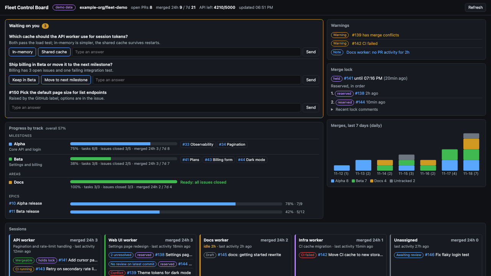

# Fleet Control Board

A canvas for supervising several Copilot agent sessions that work on one GitHub repository through issues, pull requests, reviews and merges. One screen answers: what is waiting on me, how far along is each milestone, which PR is stuck at which gate, and how fast is work landing.



## What it shows

- **Waiting on you**: questions that agents put on the board (choice buttons or a free answer), plus open issues carrying a decision label. Agents read the answers back with `get_answers`.
- **Progress by track**: one row per configured label (milestone, area, phase, …) with checklist progress from issue bodies, closed/total issues, and merges in the last 24 hours and 7 days. A track with no open issues shows as ready. Optional epic bars use GitHub sub-issue progress.
- **Sessions**: one card per agent session with its open PRs. Each PR shows the first merge gate it has not passed: draft, conflict, CI failed, CI running, changes requested, unresolved threads, awaiting review, no review on the latest commit, or mergeable. Sessions idle longer than `idleMinutes` are flagged. PRs that match no session appear under *Unassigned*.
- **Merge flow**: stacked bars per hour for the last 24 hours and per day for the last 7 days, colored by track, plus a recent-merge list. Times use your machine's time zone.
- **Warnings**: CI failures, conflicts, PRs idle for a day, idle sessions, an expired merge lock, a low GitHub API budget, and (optional) local memory, swap and heavy-process limits.
- **Merge lock** (optional): reads lock, reserve and release lines from comments on a coordination issue.

The page is in English, and in Korean when the browser language is Korean.

## Open it

```text
open_canvas fleet-control-board { "repo": "owner/name" }
open_canvas fleet-control-board { "demo": true }
```

`demo: true` shows fictional sample data and needs no GitHub access.

## Actions

| Action | Purpose |
| --- | --- |
| `refresh` | Collect from GitHub now and return a compact summary. |
| `get_summary` | Return the summary, using a one-minute cache. |
| `configure_board` | Set `sessions`, `tracks`, `epics`, `decisionLabel`, `coordinationIssue`, `lockPrefixes`, `localResources`, `idleMinutes`. Only the fields you pass change. |
| `set_decisions` | Replace (default) or append (`mode: "append"`) the questions waiting on the user. |
| `get_answers` | Answers given on the board that have not been marked seen. |
| `mark_answers_seen` | Mark answers handled; their questions leave the board. |

Example configuration:

```json
{
  "sessions": [
    { "id": "api", "name": "API worker", "branchPatterns": ["^api/"] },
    { "id": "docs", "name": "Docs worker", "titlePatterns": ["^docs:"], "prs": [42] }
  ],
  "tracks": [
    { "label": "milestone: alpha", "name": "Alpha", "group": "Milestones" },
    { "label": "area: docs", "name": "Docs", "group": "Areas", "titlePattern": "^docs:" }
  ],
  "epics": [{ "number": 10, "name": "Alpha release" }],
  "decisionLabel": "needs-decision",
  "coordinationIssue": 1
}
```

### How a merge is attributed to a track

1. The PR's own labels.
2. The labels of issues the PR closes or references (`#123` in the title or body).
3. The labels of those issues' parent (epic) issues.

If several tracks match at one step, the one listed first wins. Only when no label matches is each track's optional `titlePattern` tried against the PR, issue and parent titles. Anything left is *Untracked*.

### Session matching

A PR belongs to the first session that lists its number in `prs`; otherwise the first whose `branchPatterns` match the head branch; otherwise the first whose `titlePatterns` match the title.

### Merge lock comments

When `coordinationIssue` is set, the first line of each comment from the last 48 hours is read. With the default prefixes:

```text
merge reserve: #138
merge lock: #141 until 14:30Z
merge lock release: #141
```

The expiry is optional and can be an ISO timestamp or `HH:MM` followed by `Z`, `UTC` or an offset such as `+09:00`. Change the prefixes with `lockPrefixes`.

## Requirements

- GitHub Copilot app with canvas support.
- The [GitHub CLI](https://cli.github.com/) (`gh`), signed in with access to the repository. The board never reads or stores tokens; every GitHub call goes through `gh`.

## Data and privacy

- The board runs a local server on `127.0.0.1` with a random port. It accepts only requests whose `Host` is that address, and answers only same-origin JSON posts.
- Board settings, questions and answers are stored per repository in `<copilot-home>/extension-data/fleet-control-board/` (`COPILOT_HOME`, or `~/.copilot` when unset). Files carry a format marker and version and are written atomically; a file the extension did not write is left untouched.
- Local resource checks are off by default.

## Development

```bash
node --test test/*.test.mjs
```
