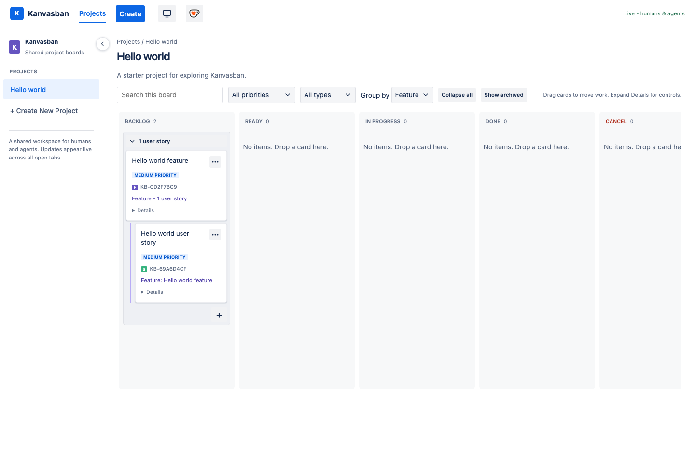

# Kanvasban

A Jira-inspired Copilot canvas for humans and agents to manage shared projects,
Features, and user stories.

## Support

The cup-and-heart button beside the theme control opens
[Ko-fi](https://ko-fi.com/johnny888) using a normal link without a `target`
attribute. This navigates the current view instead of requesting a new window,
which some embedded canvas browsers block.
The cup icon is inlined in `index.html` as an SVG that embeds the original
PNG, so it renders offline and makes no request to Ko-fi. No remote widget
script is loaded.

## Installation

Install the [Kanvasban plugin](../../plugins/kanvasban/README.md):

```sh
copilot plugin install kanvasban@awesome-copilot
```

Requires a Copilot host that supports SDK canvas extensions. The reusable
source lives in this directory; the plugin manifest lives separately under
`plugins/kanvasban/`.

All repositories use one personal board with multiple projects. This is local
to this machine and Copilot home; it is not account-wide cloud synchronization.
Other Copilot clients may not support this extension contract.

After code changes, reload extensions, discover `kanvasban`, open it, and
call `listProjects` to verify it. Reopen the same instance to verify persistence.
When developing, use an isolated `COPILOT_HOME` to avoid changing your personal
board. A project extension with the same directory name shadows a user-level
installation.



### Tests

From this extension directory:

```sh
node --check extension.mjs
node --test backlog.test.mjs
```

Tests require Node.js 24 or later for `node:module` registration hooks.
Tests use temporary Copilot homes and do not modify your personal board.
Do not install the SDK: the Copilot host supplies it at runtime.

## Projects and navigation

- Select a project in the primary sidebar.
- Use **Create New Project** to add a project with a name and optional description.
- Click a project's pencil icon to edit it.
- Use the arrow on the sidebar's right edge to collapse or expand navigation.
- Use the top-bar **Create** button to add an item to the selected project.

Each project has its own cards, Feature hierarchy, counts, and manual order.
Parent links and reorder targets cannot cross project boundaries. Project
deletion and moving items between projects are not provided.

The selected project belongs to the current view and is retained in its
`?project=` URL. Switching projects clears item-creation drafts, expanded card
details, and search, type, and priority filters. Project navigation also works
on narrow screens.

Project names and descriptions update live. Open project-edit forms retain
unsaved drafts rather than replacing them with incoming updates.

## Workflow and card order

Columns appear in this order:

| Column | Stored status |
|---|---|
| Backlog | `backlog` |
| Ready | `ready` |
| In progress | `in-progress` |
| Done | `done` |
| Cancel | `cancelled` |

Drag cards between columns or above/below another card to set shared, persistent
order. A blue line marks the insertion point. New items append to Backlog.

Expand a card's **Details** for keyboard-accessible **Move up**, **Move down**,
and status buttons, plus type, priority, parent, description, and acceptance
criteria controls. Priorities are `low`, `medium`, and `high`.

The board has no status dropdown or delete button. Move work to **Cancel** to
preserve its history, and move it back to resume.

## Features and grouping

Features sit above user stories in the hierarchy. A user story can optionally
link to a parent Feature; standalone stories are valid. Features cannot have
parents. Cards show their parent Feature or child count.

Use the **Parent Feature** control in card Details to link or unlink a story.
It is also available in the title-click details pop-over: click **No parent
Feature** (or the current parent), choose a Feature from the same project, and
save with the blue check. Choose **No parent Feature** to unlink. **X** or
**Escape** discards the selection. Features do not show this control.
Cancelling a Feature does not cancel its children. A Feature with children
cannot be permanently deleted or converted into a user story until those
children are unlinked or reassigned.

### Group by None

This is the default. Features and user stories can mix freely in each column.

### Group by Feature

Linked stories nest beneath their parent Feature in each status column.
Stories retain their own statuses. A parent context heading appears when the
Feature is in another column or filtered out. Unlinked stories remain standalone.

- Use a group's disclosure chevron to collapse or expand its stories.
- The Feature card, visible story count, and **+** button stay available.
- The same Feature expands or collapses across all columns.
- A single **Collapse all / Expand all** button beside Group by controls every
  Feature, including newly appearing groups. If any Feature is collapsed, the
  button offers **Expand all**.

Expansion is local view state and survives live updates and filtering. It does
not change board data or another user's view.

Reordering within a Feature changes sibling order, not parent links. Moving a
Feature does not move its children.

### Create a child story

Click **+** at the bottom of a Feature group to open Create with **User story**
and that parent Feature preselected.

New stories still start in **Backlog**, regardless of the column containing the
clicked group.

## Search and filters

Search the board or filter by type and priority. Press **Escape** in search to
clear the query and remove focus.

Grouping and filters are local view choices; manual order is shared. With
filters enabled, dragging places an item relative to visible cards without
losing hidden items.

## Creating items

Use the top-bar **Create** button for a Feature or user story, or a Feature
group's **+** button for a preselected child story.

**Escape**, **Cancel**, and **X** close the dialog and discard its draft.
Defaults return to **User story**, **no parent Feature**, and **Medium priority**.
Feature-group buttons apply their parent defaults afresh on each opening.

Successful creation closes and resets the dialog. Validation and save errors
stay visible inside it. Dismissal is disabled while saving, and focus returns
to the opening control.

In project dialogs, **Escape** also clears the draft and closes without saving.
Dismissal is disabled while a project save is in flight.

## Card details and inline editing

Click a card title to open its details pop-over, separate from Create.
Click the title, description, or acceptance criteria to edit inline.

The **X** cancels and the **blue check** saves, in that order. Single-line fields
keep these controls inside the input; multiline fields place them underneath.

Only one inline field can be edited at a time. Opening another cancels the
previous field's unsaved draft. Switching fields is disabled while saving.

| Key | Behavior |
|---|---|
| Enter in Title | Save |
| Enter in a multiline field | Insert a newline |
| Ctrl/Cmd+Enter in a multiline field | Save |
| Escape during inline editing | Cancel the current edit |
| Escape with no inline edit | Close details and return to the board |

Drafts survive live updates, and save errors retain input. Detected same-field
changes require cancelling and re-editing.

## Comments and history

The **Comments** and **History** tabs at the bottom of details show live activity.

Comments support adding, editing, and confirmed soft deletion. Editable author
labels default to **Human** in the browser and **Agent** for agent actions.
These labels are not authentication or permissions: any local board user can
edit comments.

History records creation, actual field/status changes, reordering, and comment
changes with actor, timestamp, and before/after values. Previous comment text
remains in history after deletion.

Older items have no reconstructed history for activity predating tracking.

## Appearance

Click the theme icon in the top bar to cycle **Light**, **Dark**, and **System**
(the default). The sun, moon, or monitor icon and tooltip show the selected mode.
System follows device appearance changes automatically.

The choice is saved in browser local storage and shared across tabs on the same
board URL. The server uses an ephemeral port, so a provider restart may change
the origin and reset the browser preference to System.

## Live updates and concurrency

Server-sent events update open browser views without refreshing. The server
checks the canonical file every **500 ms**, including changes made by agents
and other extension processes using the same personal data file.

The connection indicator reports disconnections and storage errors. Reconnecting
receives the latest snapshot. Separate clones or machines are not synchronized.

Mutations use an exclusive filesystem lock and atomic file replacement to avoid
losing unrelated concurrent writes. Edits to the same field are last-write-wins,
not exclusive assignment or story claiming.

A crashed writer may leave `backlog.json.lock`. Writes report a timeout rather
than bypassing it. Remove that empty lock directory only after confirming no
writer is active.

## Agent actions

### Card actions and archiving

Each card has an ellipsis button at the top right. **Edit** opens the same
details dialog as clicking its title. **Archive** opens a confirmation dialog;
Cancel or Escape leaves the item unchanged. Confirming removes the card from
the board, including search results and column counts, without deleting it.
Failures are shown in the dialog and can be retried.

Archiving preserves status, order, comments, history, and Feature relationships.
Archiving a Feature does not archive its stories; its name remains as parent
context for active children in Feature grouping. Archived Features cannot be
selected as new parents or used to create new children from the group.

Agents can archive with `updateStory({ id, archived: true })` and restore with
`updateStory({ id, archived: false })`. `listStories` and snapshots retain
archived records, identified by `archivedAt`; board views hide them by default.
Use **Show archived / Hide archived** in the toolbar to include archived cards
alongside active cards. Archived cards have an **Archived** badge and still
follow search, filters, grouping, and column counts. This toggle is local view
state and does not restore items. There is no restore button in the UI yet.

The canvas ID is `kanvasban`.

| Action | Purpose |
|---|---|
| `listProjects` | Discover project IDs |
| `createProject` | Create a project with `name` and optional `description` |
| `updateProject` | Edit a project using `id`, `name`, and optional `description` |
| `listStories` | List items in canonical order; pass `projectId` to select a project |
| `addStory` | Create a Feature or user story in a project |
| `updateStory` | Edit an item by its globally unique UUID |
| `reorderStory` | Move an item before another, or to the bottom |
| `changeComment` | Add, edit, or soft-delete a comment |
| `deleteStory` | Permanently delete only when explicitly requested or cleaning up test data |

Include `projectId` when creating an item; it is mandatory when multiple projects
exist. Item updates cannot change projects. Omitting `projectId` from
`listStories` lists all projects. Filter its ordered results by status to get a
column's order.

- `type`: `feature` or `user-story`.
- `parentFeatureId`: an optional Feature UUID; use `null` to unlink.
- `reorderStory`: supply `id`, `beforeId` (another item ID, or `null` for the
  bottom), and optional destination `status`.
- Supply `actor` for an agent's display label. Agent actions default to `Agent`.
- Use `changeComment` for comments and `listStories` to read comments/history.

Agents receive current state when calling actions. Live updates do not wake
agents or inject messages into their conversations.

See the [agent workflow](./AGENTS.md) for coordination rules. This guide is not
automatically installed as global agent instructions.

## Data

The canonical personal data is `extension-data/kanvasban/backlog.json`
under your Copilot home, separate from the installed code. A nonempty
`COPILOT_HOME` is used exactly as provided; otherwise the home is `~/.copilot`.
All repositories, sessions, and canvas instances using that home view this same
file, not separate boards.

Format `kanvasban`, version **2**, contains a nonempty `projects` array and a
`projectId` on every item. Items without a stored type load as standalone user
stories. Display keys use `KB-` without changing stored UUIDs.

No store or personal board data ships with the plugin. When the file is missing,
the first read or write creates its parent directories and initializes exactly
one **Hello world** project, one feature, and one linked user story. Initialization
uses the same lock and atomic write as edits, so concurrent first use does not
duplicate the sample or lose changes. The seed is created at runtime, not copied
from a bundled store.

Existing stores, including projects with no items, are never reseeded. Corrupt,
unreadable, or unsupported data is reported explicitly and is not overwritten.
Removing the entire store causes the next access to initialize it again. Keep
backups outside your repository.
