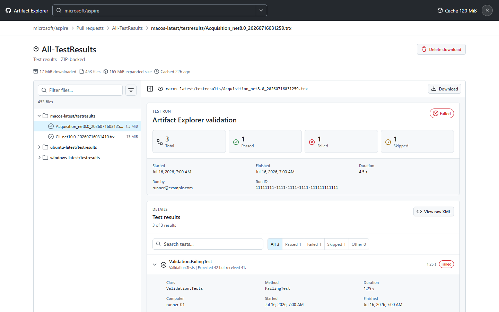

# Artifact Explorer

> **GitHub, the missing parts:** GitHub Actions makes artifacts easy to produce, but pull-request reviewers still have to download opaque ZIP files and inspect them out of context. Artifact Explorer turns those artifacts into a fast, GitHub-native, navigable experience inside Copilot, whether they came from a pull request or from a scheduled, manual, push or release run.

Artifact Explorer is a community-built Copilot canvas extension with the internal extension ID `pr-artifact-explorer`. It is not an official GitHub product or endorsed feature.

<picture>
  <source media="(prefers-color-scheme: dark)" srcset="assets/preview-dark.png">
  <source media="(prefers-color-scheme: light)" srcset="assets/preview.png">
  
</picture>

## What it does

- Navigates repositories, pull requests, workflow runs, artifacts, and files with persistent breadcrumbs.
- Browses workflow runs that have no pull request. A repository-level **Workflow runs** tab lists runs from any trigger (scheduled/cron, manual, push, release, and more) with event, status, workflow and branch pickers (the branch picker autocompletes real branches), paging, and linked-PR chips. "Hide PR runs" and "Has artifacts" are on by default, so the list starts with runs that have no pull request and produced artifacts; turn either off to see everything. Artifact counts load lazily per run. A run page lists its artifacts and reuses the same preview, Browser view, sharing and Re-run features.
- Loads pull requests progressively, caches result pages, and supports query filters for fast review.
- Bounds artifact discovery to the newest 30 workflow runs per head commit and reports when older runs are omitted.
- Downloads an artifact once, indexes its ZIP, and streams entries directly from the archive without extracting them to disk.
- Previews root-level static sites in a sandboxed loopback frame when the artifact contains `index.html`.
- Plays asciinema terminal recordings and renders structured TRX and JUnit XML test reports (content-detected; other XML keeps the plain viewer). Plays `.webm`, `.mp4` and `.mov` with native video controls and byte-range seeking; playback depends on the browser's codecs, with a download fallback. A contextual "Browser view" action appears only when previewing an HTML artifact.
- Syntax-highlights JSON and XML, previews images and PDFs, renders text with safe escaping, and identifies binary content.
- Keeps large files available for direct download and falls back to the original artifact archive when a ZIP entry uses an unsupported encoding.
- Provides per-artifact cleanup, clear-all cleanup, and a cache usage view.
- Uses a responsive Primer interface that follows Copilot's light and dark themes.
- Runs downloads, indexing, and decompression as recoverable background jobs that are independent of any request or view, with progress (percent, bytes, speed, time left) in a sized panel that toast messages stack above. Closing the view, retrying, or restarting the canvas never kills them, and a completed ZIP is reused on retry. A provider termination is reported honestly as `interrupted` with a Retry action.
- Soft limits (download size, ZIP entries, central-directory size, streamed entry size, idle time) never stop work. When one is crossed the job keeps running and the canvas asks for a larger value; the new limit must be at least the live value at submission and is checked atomically against live progress.
- Supports ZIP64 and validates the full central directory. The only hard stops are real integrity, safe-integer, path, and free-disk guards; there are no hidden size ceilings.
- Provides a browser-style preview for localhost and HTTP(S) URLs: Mobile/Tablet/Desktop/Native/Custom viewport presets, windowed zoom (separate from the viewport), back/forward/refresh, natural-language navigation, and a keyboard-hint overlay (`?`). Pages that forbid framing are reported, never bypassed.
- Captures real Playwright/Chromium screenshots with device emulation. `screenshot` defaults to a fresh render (labelled `fresh-render`); `mode: "controlled"` captures the live isolated Chromium page (`controlled-current`). PNGs are saved under the session `files/artifact-explorer-screenshots` folder.
- Offers an isolated controlled Chromium (in-memory profile, no login state) with real back/forward/refresh that survives device changes, for sites that block embedding.
- Includes copy buttons after titles and a `#number` link to the canonical GitHub issue or pull request, with an adjacent copy-link button.
- Ships a built-in Docs tab and a sharing skill (`pr-artifact-explorer`) for share links, artifact IDs, and routes.

## Screenshot setup

Screenshots need Playwright and a Chromium browser. Nothing is installed silently:

```text
npm install                       # in the extension folder; installs optional playwright-core
npx playwright-core install chromium
```

Playwright is loaded lazily from the extension's own `playwright-core` dependency; loading it from arbitrary paths is not supported. The legacy `PR_ARTIFACT_EXPLORER_PLAYWRIGHT` variable is rejected with an explicit `playwright_config_unsupported` error until it is unset. Optional: `PR_ARTIFACT_EXPLORER_CHROMIUM` (path to a Chromium/Chrome/Edge executable). Without a runtime the action returns explicit setup instructions. A fresh isolated profile is used for every capture; no login profile is persisted.

## Security and local data

Artifact Explorer inherits eligible GitHub accounts from the Copilot app, GitHub CLI, or process environment. Tokens remain inside the extension process: the canvas receives only sanitized account metadata, while authenticated GitHub API requests are made by the local extension server.

Artifact ZIPs and preferences are stored under:

```text
$COPILOT_HOME/extensions/pr-artifact-explorer/artifacts/
```

When `COPILOT_HOME` is unset, it defaults to `~/.copilot`. Cached archives remain local until removed through the per-artifact or clear-all controls.

The canvas server validates its canonical loopback host and requires a per-instance capability token for API, artifact-content, and event requests. Static-site previews bind to a separate ephemeral `127.0.0.1` port, validate their loopback host, apply a restrictive content security policy, prevent path traversal, and stream files from the ZIP. A preview requires `index.html` at the artifact root. Static content is untrusted, remains sandboxed by the canvas, and has no access to GitHub tokens.

## Install

Ask Copilot to install the committed extension:

```text
Install this extension: https://github.com/github/awesome-copilot/tree/main/extensions/pr-artifact-explorer
```

You can also copy the folder to one of the supported extension locations:

- `~/.copilot/extensions/pr-artifact-explorer/` for user scope
- `.github/extensions/pr-artifact-explorer/` for project scope

Reload extensions, then ask Copilot to open the `pr-artifact-explorer` canvas. You can optionally provide a repository (`owner/name`), pull request number, workflow run ID, or a GitHub pull request, run, or Actions URL when opening it.

## Agent actions

- `open_pull_request { repository, pullNumber }` - navigate an open canvas to a pull request.
- `open_runs { repository, event?, status?, branch?, workflow?, excludePullRequests?, hasArtifacts? }` - open a repository's workflow runs (for example `event: "schedule"` for cron runs). `excludePullRequests` and `hasArtifacts` default to true; pass false to include PR runs or runs with no artifacts.
- `open_run { repository, runId }` - open one workflow run and its artifacts.
- `open_target { input }` - open any share link, URL, issue/PR, workflow run or Actions page, artifact, or route.
- `inspect_artifact { repository, artifactId }` - start a recoverable job to download, index, detect, and open an Actions artifact.
- `job_status`, `retry_job`, `cancel_job`, `set_limit { kind, value }` - manage jobs and soft limits.
- `restart_canvas` - restart the instance (same port and token) without stopping jobs.
- `navigate_browser`, `set_viewport`, `set_zoom`, `screenshot` - drive the browser preview.
- `controlled_navigate`, `controlled_back`, `controlled_forward`, `controlled_refresh`, `controlled_close` - drive the isolated controlled Chromium.
- `share { input, preset?, zoom?, width?, height? }` - build shareable links that round-trip through `open_target`.
- `docs { section? }` - open the built-in Docs tab.
- `cache_status` - report local artifact cache usage.
- `clear_cache { artifactId? }` - remove one cached artifact or clear the entire cache.
- `accounts` - list sanitized GitHub account metadata available to the extension.
- `set_account { id }` - select the GitHub account used for repository and artifact requests.

## Included third-party components

The extension bundles Primer CSS, Octicons, and the asciinema player for offline rendering. Their notices are preserved in `third-party-licenses/`.
