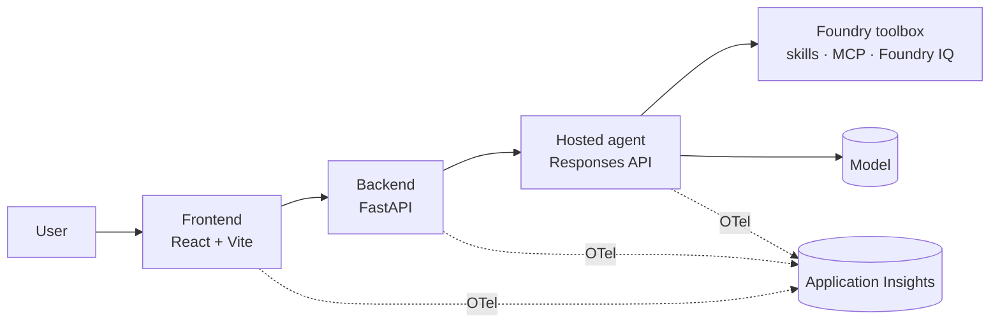

# {Solution} — Specification

> Last updated: {YYYY-MM-DD} · Scenario: {canvas scenario or n/a} · Deployment plan: [.azure/deployment-plan.md](../.azure/deployment-plan.md)

## 1. Summary

One paragraph: what is built, for whom, why, and the measurable outcome.

## 2. Goals and non-goals

**Goals:** {measurable outcomes}

**Non-goals:** {explicitly out of scope}

## 3. Users and scenarios

| Persona | Scenario | Success criteria |
| --- | --- | --- |
| {persona} | {scenario} | {observable outcome} |

## 4. Functional requirements

| ID | Requirement | Acceptance criteria (EARS) | Priority |
| --- | --- | --- | --- |
| FR-001 | The system shall {capability} so that {benefit}. | When {trigger}, the {component} shall {response}. | Must |

## 5. Non-functional requirements

| Category | Requirement | Measure |
| --- | --- | --- |
| Performance | {e.g. first token < 3 s at p95} | {how measured} |
| Security | Keyless managed identities; least-privilege RBAC; no secrets in code | RBAC contract rows |
| Responsible AI | Foundry guardrails on; grounded answers cite sources; refusal when evidence is insufficient | Evaluation metrics |
| Observability | OpenTelemetry from every component into one Application Insights | Correlated trace |
| Privacy and compliance | {data classification, residency} | {control} |
| Cost | {budget or main drivers} | {estimate} |

## 6. Architecture

{Two or three sentences on components, data flow and trust boundaries.}

## 7. Agents

| Agent | Purpose | Framework | Protocol | Model | Toolbox, skills and tools | Grounding | Guardrails |
| --- | --- | --- | --- | --- | --- | --- | --- |
| {name} | {job} | Copilot SDK or MAF | Responses | {deployment} | {toolbox and items} | {Foundry IQ source or none} | {policy} |

## 8. Components and Azure services

| Component | Technology | Azure service and SKU | Identity |
| --- | --- | --- | --- |
| {frontend} | React + Vite | Container Apps (Consumption) | {uami} |

## 9. Data

Entities, fields, ownership, retention and classification. Name the sample or synthetic data source and where it lives.

**Seed rules.** For every seeded record a rule reads, freeze the values the rule needs (dates, counts, amounts, window anchors) and each tool's result for that ID, including empty results. Labels and names carry no decision facts.

## 10. Implementation contract (frozen)

Service names, environment variables, endpoints, protocols, request, response and error schemas, streaming, auth and versions. Change this section before changing any code that depends on it.

**Decision rules.** Each rule reads only frozen facts or tools in the consuming agent's list, and a decision tool has a frozen derivation. A window names its anchor date; trigger categories are closed lists. Guards, routing and sort keys cover every enum value plus null or invalid agent output. Recompute each scenario's expected outcome from these rules. Tables keep the header's cell count. Describe credentials and `Authorization` values in words, never as literals.

## 11. Workstreams

| # | Workstream | Goal | Exclusive files | Depends on | Acceptance |
| --- | --- | --- | --- | --- | --- |
| 1 | {name} | {goal} | `src/{dir}/**` | Foundation | {checks} |

At most four. The phase lead owns the foundation, the contract, shared configuration and integration.

## 12. Verification plan

| Requirement | Check | Level | Evidence |
| --- | --- | --- | --- |
| FR-001 | {probe} | unit, contract, E2E, evaluation or trace | {artifact} |

**Evaluation:** {n} scenarios from section 3 with expected behaviour; metrics: task adherence, groundedness (when grounded) and safety.

## 13. Assumptions and open questions

| # | Item | Default or decision | Owner | Status |
| --- | --- | --- | --- | --- |
| 1 | {assumption} | {default taken} | {owner} | assumed |
