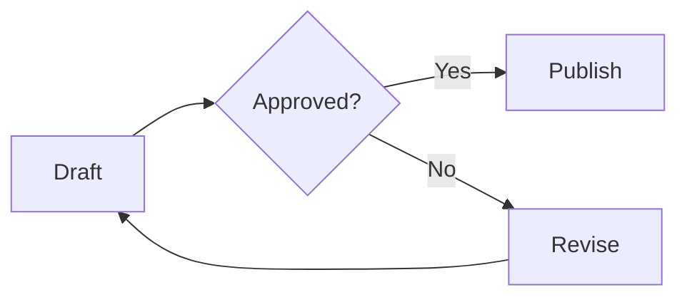
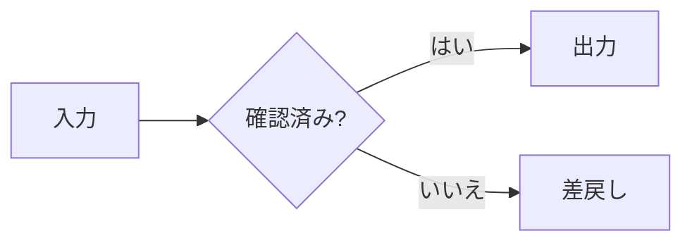
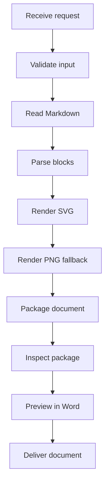

This synthetic example contains no project or customer data.

## Approval flow

The document owner submits a draft. A reviewer either approves it or requests changes.

## Japanese labels

## Tall diagram

This diagram exercises scaling and the explicit page-break rule.

## Ordinary content

| Item | Expected result |
| ---- | --------------- |
| SVG  | SVG retained    |
| PNG  | PNG retained    |
| Text | Both languages  |

- Keep the Markdown source.
- Check the document in Word.

> Vector output is not an editable Office flowchart.
